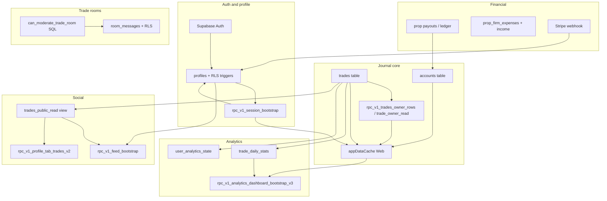

# TradeTraxs — Dependency, Regression Risk & Architectural Fragility Audit

**Date:** 2026-10-24  
**Mode:** Read-only — no code edits, builds, tests, simulators, or deployments.  
**Question:** Which seemingly small changes could unexpectedly break major parts of TradeTraxs?  
**Related:** [INFRASTRUCTURE_SCALABILITY_COST_AUDIT_2026-10-24.md](./INFRASTRUCTURE_SCALABILITY_COST_AUDIT_2026-10-24.md), [FEED_CONCURRENCY_COST_FRAGILITY_AUDIT_2026-10-24.md](./FEED_CONCURRENCY_COST_FRAGILITY_AUDIT_2026-10-24.md), [VIRAL_GROWTH_READINESS_AUDIT_2026-10-24.md](./VIRAL_GROWTH_READINESS_AUDIT_2026-10-24.md), [docs/backend-v2/README.md](../docs/backend-v2/README.md).

**Legend:** **Confirmed** = evidenced in repo. **Potential** = plausible failure mode without a known open bug.

---

## Final report (executive)

| Deliverable | Summary |
|-------------|---------|
| **Top 15 highest-risk artifacts** | §2 — `appDataCache`, bootstrap RPCs, `trade_daily_stats` pipeline, broker sync, Stripe webhook, profile gates, public trade projection, Backend V2 flags |
| **Dependency map** | §1 — mermaid + hub table |
| **10 most dangerous regressions** | §2.2 |
| **Web/iOS compatibility** | §3 |
| **Migration risks** | §4 |
| **5 safeguards** | §7 |
| **Pre-scale priorities** | §8 |

---

## 1. Hidden dependencies & feature map

### 1.1 Architecture hub (confirmed)

Most product surfaces are **not isolated pages**. They share:

| Hub | Role | Primary evidence |
|-----|------|------------------|
| **`profiles` + session** | Entitlements, onboarding, display, billing mirrors | `lib/UserProfileProvider.tsx`, `lib/subscriptionAccess.ts`, `rpc_v1_session_bootstrap` |
| **`trades` + owner RPCs** | Journal, dashboard window, profile public cards, feed posts, analytics input | `lib/tradeOwnerRead.ts`, `rpc_v1_trades_owner_rows`, `rpc_v1_trade_owner_read` |
| **`trade_daily_stats` + `user_analytics_state`** | Dashboard V3, calendar aggregates, revision/repair | `20260921120000_trade_daily_stats_analytical_foundation.sql`, analytics RPC migrations |
| **`trades_public_read` view** | Non-owner trade visibility (Feed, Profile, Leaderboard boundaries) | `20260929221000_trades_public_read_boundary.sql`, `lib/publicAccountPrivacy.ts` |
| **`lib/appDataCache.ts`** | Web trades/accounts module cache; seeds dashboard, calendar hooks, streaks, broker realtime overlay | `lib/dataPrefetch.ts`, `lib/useBrokerImportedTradesRealtime.ts` |
| **Backend V2 flags** | Web vs iOS choose RPC vs REST paths | `lib/backendV2/flags.ts`, `native-ios/.../BackendV2FeatureFlags.swift` |
| **DB triggers** | Free plan, rate limits, analytics revision bumps, room moderation | Migrations under `supabase/migrations/` |
| **Broker canonical sync** | Tradovate/Rithmic → `trades` + lifecycle keys | `lib/integrations/tradovate/syncTradovateBrokerAccount.ts`, `persistBrokerTrades.ts` |

### 1.2 Dependency map (major features)



### 1.3 Coupling matrix (who reads whom)

| Feature | Depends on | Single point of failure? |
|---------|------------|---------------------------|
| **Dashboard** | `appDataCache`, optional `rpc_v1_dashboard_bootstrap`, `trade_daily_stats` (V3), accounts | **Yes** — cache + RPC shape |
| **Trades list / Analyst** | `rpc_v1_trades_owner_rows` (full history paths), `appDataCache` | **Yes** — owner RPC projection |
| **Calendar / Analytics** | `trade_daily_stats`, `user_analytics_state.revision`, GRDB on iOS (flags) | **Yes** — aggregate pipeline |
| **Profile (public)** | `trades_public_read`, `rpc_v1_profile_tab_trades_v2`, pinned content RPCs | **Yes** — view column set |
| **Feed** | `rpc_v1_feed_bootstrap`, Realtime, public trade/post tables | RPC + Realtime |
| **Achievements** | Trades, payouts, posts — mostly separate bootstraps but shares **trade visibility** rules | Partial |
| **Payouts / prop firm** | Account balance RPCs, ledger, new `prop_firm_payout_assignments` | Triggers on delete payout (**Confirmed** restore migration) |
| **Expenses / income** | `prop_firm_expenses` schema + analytics export paths | CHECK constraints / enums |
| **Accounts settings** | `accounts` triggers (free plan), dual-write `account_settings` | **Yes** — triggers + mirrors |
| **Messaging / rooms** | `rpc_v2_messaging_bootstrap`, room RLS, **`can_moderate_trade_room`** | RLS + SQL helpers |

### 1.4 Shared caches (confirmed)

| Cache | Location | Consumers (non-exhaustive) |
|-------|----------|----------------------------|
| Trades / accounts | `lib/appDataCache.ts` | Dashboard, Calendar, Trades, prefetch, broker realtime, streaks invalidation |
| Session bootstrap | `lib/backendV2/sessionBootstrapCache.ts` | Navbar, settings hints, profile shell when flag ON |
| Feed bootstrap | `lib/backendV2/feedBootstrapCache.ts` | Feed page — **explicit: Realtime patches, no re-bootstrap** |
| Messaging | `lib/backendV2/messagingBootstrapCache.ts` | Inbox |
| Trade detail | `lib/tradeDetailCache.ts` | Trade detail modals |
| iOS GRDB analytics | `native-ios/.../Data/Analytics/Local/` | Dashboard/calendar when GRDB flags ON |

---

## 2. Regression hotspots

### 2.1 Top 15 highest blast-radius files / functions / DB objects

| # | Artifact | Why a “small” change hurts | Features at risk |
|---|----------|----------------------------|------------------|
| 1 | **`lib/appDataCache.ts`** | Central trades/accounts truth for Web; broker patch queue; `historyComplete` vs `analyticsHistoryComplete` flags | Dashboard, Trades, Calendar, imports, streaks, reports |
| 2 | **`rpc_v1_trades_owner_rows` / `rpc_v1_trade_owner_read`** (SQL migrations) | Every owner read path; column renames break Web + iOS | Journal, edit trade, dashboard bootstrap, iOS `DefaultTradeRepository.swift` |
| 3 | **`trade_daily_stats` + triggers + `analytics_bump_user_revision`** | All V3 dashboard/calendar aggregates | Analytics, tax export inputs, profile statistics |
| 4 | **`public.trades_public_read` view** | Must match `PUBLIC_TRADE_SELECT` / `lib/publicAccountPrivacy.ts` | Feed, Profile trades, Leaderboard boundaries, copy-trade |
| 5 | **`lib/backendV2/flags.ts`** + **`BackendV2FeatureFlags.swift`** | Flips entire network stack (RPC vs REST) | **Cross-platform divergence** — see §3 |
| 6 | **`rpc_v1_session_bootstrap`** + **`lib/UserProfileProvider.tsx`** | Profile, entitlements, warm paths on auth | Global app gate, settings, checkout reconciliation |
| 7 | **`lib/subscriptionAccess.ts`** + **`profile_is_pro_user()`** (SQL) | Who bypasses free limits / paywall | Accounts, posts, messaging, CSV |
| 8 | **`lib/integrations/tradovate/syncTradovateBrokerAccount.ts`** + **`persistBrokerTrades.ts`** | Canonical broker write path | Sync, imports, analytics downstream |
| 9 | **`app/api/stripe/webhook/route.ts`** | Mirrors `profiles` + `billing_accounts`; often returns 200 on inner failure | Entitlements, `is_pro`, affiliate commissions |
| 10 | **`lib/ensureProfileForUser.ts`** | Signup shell; **`is_pro: true` on insert** vs DB default false | **Potential** silent Pro bypass for limits |
| 11 | **`lib/profileSplitMirrorWrites.ts`** | Dual-write to `account_settings` / `billing_accounts` | Onboarding flags, Stripe customer id — **partial write drift** |
| 12 | **`rpc_v1_feed_bootstrap`** | Single JSON blob for Feed | Feed Web + iOS; engagement maps embedded |
| 13 | **`profiles_reject_privileged_self_update`** (trigger) | Any new “privileged” column must be added here | Security + billing fields |
| 14 | **`can_moderate_trade_room` / `has_room_moderator_tag`** | New moderator model tied to tag name **`Moderator`** | Rooms Web + iOS + RLS policies (`20261024163000_trade_room_moderator_permissions.sql`) |
| 15 | **`lib/database.types.ts`** (generated) | Stale types mislead refactors; not runtime — but **RPC arg renames** break clients at runtime | All `.rpc()` calls |

### 2.2 Ten most dangerous potential regressions

| # | Change | Failure mode | Obvious vs silent |
|---|--------|--------------|-------------------|
| 1 | Rename/drop column on **`trades`** without updating view + RPCs | 500 on bootstrap; empty Feed/Profile | **Obvious** |
| 2 | Alter **`trades_public_read`** without updating `PUBLIC_TRADE_SELECT` | Public UI shows wrong/missing fields; **leak** journal fields if view too wide | **Silent** (privacy) |
| 3 | Change **`trade_daily_stats`** grain or timezone function | Dashboard/calendar numbers drift from journal | **Silent** |
| 4 | Toggle **`free_plan_limits_enforced()`** or **`profile_is_pro_user`** logic | Sudden blocks or unlimited usage | Mixed |
| 5 | **`mergeTradesInCache` / partial RPC rows** merging over full rows | UI shows trades missing PnL/fields until hard refresh | **Silent** |
| 6 | **`seedTradesCache`** with wrong `fetchedAt` | Older IndexedDB snapshot wins over newer network data | **Silent** |
| 7 | Stripe webhook handler error swallowed with **HTTP 200** | User paid but `is_pro` false | **Silent** |
| 8 | Broker sync **`broker_lifecycle_id`** / upsert key change | Duplicate trades or stuck “missing” imports | **Silent** data |
| 9 | **`rpc_v1_feed_bootstrap` JSON shape** (rename keys) | Feed blank on older app versions | **Obvious** on old clients |
| 10 | Room tag rename **`Moderator` → something else** without SQL + TS + Swift | Moderators lose powers or RLS denies actions | **Obvious** for mods |

### 2.3 Silent corruption vs loud failures (confirmed mechanisms)

- **Confirmed — partial cache merge:** `upsertTradeInCache` / `mergeTradesInCache` use shallow `{ ...existing, ...patch }` (`lib/appDataCache.ts`). A patch missing fields **drops** them in the UI until refetch.
- **Confirmed — broker race mitigation:** `brokerPatchesByUser` + `overlayBrokerPatches` during in-flight history load (`applyBrokerImportedTradeToCache`) — if bypassed by a new code path, imports can **disappear temporarily or permanently** from cache.
- **Confirmed — dual-write mirrors:** `mirrorAccountSettingsOnboardingCompleted`, `mirrorBillingAccountsStripeCustomerId` (`lib/profileSplitMirrorWrites.ts`) — failure on one table → **split brain** between `profiles` and `account_settings` / `billing_accounts`.
- **Confirmed — analytics revision:** Trade mutations should bump `user_analytics_state.revision` via DB triggers (`analytics_bump_user_revision` in analytics migrations). If a new write path skips triggers, clients show **stale charts** while journal looks correct (**silent**).
- **Potential — `ensureProfileForUser` `is_pro: true`:** Inserts Pro flag while product intent is free tier (`20261007200000_profiles_signup_no_automatic_is_pro.sql` vs client insert) — **`profile_is_pro_user()`** treats as Pro (**Confirmed** code paths; **Potential** production impact depends on `free_plan_limits_enforced()`).

---

## 3. Web / iOS synchronization risks

### 3.1 Backend V2 flag divergence (**Confirmed** — high risk)

| Flag area | Web default (`lib/backendV2/flags.ts`) | iOS Release shipped (`BackendV2FeatureFlags.swift` `productionShippedFlags`) |
|-----------|----------------------------------------|-------------------------------------------------------------------------------|
| session | **OFF** | **ON** |
| dashboard | **OFF** | **ON** |
| feed | **ON** | **ON** |
| messages | **ON** | **ON** (Web); iOS also **messageThreads ON** |
| profile | **OFF** | **ON** |
| dashboardAnalyticsV3 / calendarAnalyticsV2 | N/A (web uses separate paths) | **ON** |
| viewerSyncState / analyticsRevisionRepair | **OFF** | **ON** |
| profileTradesSummaryV2 | Web profile tab paths differ | **ON** on iOS |

**Consequence:** A backend change validated only on **Web** (REST + `fetchSettingsProfileRow`, `ensureTradesLoaded`) may **break TestFlight/App Store** builds that always call **`rpc_v1_session_bootstrap`**, **`rpc_v1_dashboard_bootstrap`**, **`rpc_v1_profile_tab_trades_v2`**, and analytics V3 RPCs.

**Evidence:** `UserProfileProvider.tsx` uses session bootstrap only when `resolveBackendV2Flag("session").enabled`; otherwise REST profile fetch. iOS ships session+dashboard ON without requiring env vars.

### 3.2 Shared contracts implemented differently

| Contract | Web | iOS | Risk if SQL changes |
|----------|-----|-----|---------------------|
| Owner trades | `lib/tradeOwnerRead.ts` | `DefaultTradeRepository.swift` | Both call same RPC names — **good**; projection change hits both |
| Feed page size | `FEED_PAGE_SIZE = 8` (`lib/feedContent.ts`) | Default **20** in feed bootstrap | Different load — not breakage, but **different DB cost** |
| Public trades | REST/RPC via `trades_public_read` | Profile tab V2 RPC | View column drift breaks both |
| Trade visibility / privacy | `lib/publicAccountPrivacy.ts` | Swift models + RPC whitelist | **Manual sync required** |
| Room moderation | `lib/tradeRoomModerationPermission.ts` | `TradeRoomModerationPermission.swift` | Tag name **Moderator** must match SQL `lower(trim(t.name)) = 'moderator'` |
| Entitlements | `lib/subscriptionAccess.ts`, monetization DB | iOS billing providers + session bootstrap fields | Checkout / Apple vs Stripe divergence |
| Pagination cursors | Feed cursor in TS | Swift cursor types in `FeedBootstrapRepository.swift` | Cursor string format change breaks old iOS |

### 3.3 Older iOS release breakage scenarios (**Potential**)

1. **Remove or rename RPC** still called from shipped binary (no feature flag guard).
2. **Tighten RLS** without new GRANT on `SECURITY INVOKER` helpers (room moderation grants in `20261024163000_...sql` pattern).
3. **Require new JSON fields** in bootstrap without optional parsing on older clients.
4. **Change `rpc_v2_messaging_bootstrap`** shape while old app still expects v1 fields (messaging tests document v1 removal — **Confirmed** in `messagingBootstrapContract.test.ts`).

### 3.4 Contract tests already in repo ( leverage for safeguards)

- `lib/backendV2/rpcContractSchema.ts` — Session/Dashboard shape validators  
- `lib/backendV2/messagingBootstrapContract.test.ts`  
- `lib/trade/tradeSummaryV2.migration.contract.test.ts` — profile tab v2 SQL grants  
- `lib/privacy/sessionBootstrapProfileGrant.migration.contract.test.ts` — session RPC security invoker  

---

## 4. Database migration risks

### 4.1 High-risk migration categories (**Confirmed** patterns in repo)

| Pattern | Example impact | Evidence |
|---------|----------------|----------|
| **`CREATE OR REPLACE` on RPC** without rollback file | Instant client break if args/JSON change | Numerous `rpc_v1_*` migrations |
| **View rebuild `trades_public_read`** | Profile/Feed/Leaderboard column mismatch | `20260929221000_trades_public_read_boundary.sql`, profile RPC hardening |
| **Trigger on `trades` INSERT/UPDATE/DELETE** | Analytics revision, free plan, copy-trade | `trade_daily_stats` foundation, account triggers |
| **`REVOKE INSERT` on `notifications`** | Client direct insert breaks; must use server | `20260718090000_phase1_messaging_scalability.sql` |
| **CHECK / enum on financial tables** | Deploy before app sends new kinds → insert failures | `20261024033135_expense_tracker_kinds.sql`, recurrence check changes |
| **Security definer vs invoker flip** | RLS bypass or sudden denial | Session bootstrap contract test forbids definer |

### 4.2 Safe deployment ordering (recommended practice)

1. **Expand:** Add columns nullable / new RPC overload / new flags default OFF.  
2. **Dual-read:** Ship app reading old + new (iOS + Web).  
3. **Backfill:** SQL job for aggregates (`trade_daily_stats`) if needed.  
4. **Contract tests:** Run migration contract tests in CI (`*.migration.contract.test.ts`).  
5. **Contract:** Switch iOS shipped flags only after RPC stable.  
6. **Remove:** Drop old RPC/column only after min app version bump.

**Confirmed gap:** Not all migrations have paired rollbacks; broker/analytics RPCs especially.

### 4.3 Dangerous assumptions (**Potential**)

- **Column defaults** on `profiles.is_pro` (false) vs client insert true.  
- **Tag display names** (`Moderator`, `Admin`) are authorization inputs in SQL — not just UI labels.  
- **`payout_key` format** in `prop_firm_payout_assignments` regex — client must match `^(ledger|cycle):uuid$`.  
- **Analytics calendar day** vs prop-firm day — comments in `trade_daily_stats` migration state **different** day keys (**Confirmed** comment in `20260921120000_...sql`).

---

## 5. Cache & state dependencies

### 5.1 Invalidation map (confirmed)

| Event | Invalidation / patch | Gap risk |
|-------|----------------------|----------|
| Manual trade save | `prependTradeInCache` / `upsertTradeInCache` + streaks/reports | Analytics revision via **DB** — Web may not refetch V3 until revision listener |
| Trade delete | `removeTradeFromCache` | Same |
| Broker import realtime | `applyBrokerImportedTradeToCache`, patch queue | Non-broker trades ignored by broker handler |
| Logout / user switch | `clearAppDataCache`, session bootstrap invalidate | **Confirmed** `UserProfileProvider` / cache clears |
| Feed engagement | **No bootstrap invalidate** — Realtime/local merge | Stale bootstrap if RPC schema changes mid-session |
| Stripe success | Profile refresh / reconciliation poll | Webhook silent failure → stale `is_pro` |

### 5.2 Stale-over-fresh scenarios (**Confirmed**)

- **`seedTradesCache`:** Skips if in-memory `fetchedAt >= seed` — wrong timestamp → stale wins.  
- **`mergeTradesInCache`:** Server partial rows merge over richer cached rows.  
- **Dashboard bootstrap failure → REST fallback** (`ensureAccountsLoaded` / trades paths log warn then fallback) — two code paths can **disagree** on column sets (`TRADES_APP_SELECT` vs `TRADES_ANALYTICS_SELECT` in `publicAccountPrivacy.ts`).

### 5.3 Screens sharing data, refreshing differently

| Data | Dashboard | Trades page | Calendar | Profile public | iOS |
|------|-----------|-------------|----------|----------------|-----|
| Trades | `appDataCache` window / bootstrap | Full history RPC | Analytics history slice | `trades_public_read` RPC | GRDB + RPC |
| Accounts | Shared cache | Per-trade account refs | Filters | Insights RPC | Session/bootstrap |

**Weakest link:** Web **module cache** vs iOS **GRDB + revision repair flags** — same trade edit can show **different analytics** until revision repair runs on iOS only.

---

## 6. Critical user journeys

### 6.1 Signup → Onboarding → Dashboard

```
Auth → ensureProfileForUser → profiles (+ notification_preferences trigger)
     → /onboarding → onboarding_completed (+ mirror account_settings)
     → UserProfileProvider → [session RPC | REST profile]
     → warmAppDataCaches → ensureTradesLoaded | dashboard bootstrap
     → Dashboard UI
```

| Weakest dependency | Consequence |
|--------------------|-------------|
| **`ensureProfileForUser` + profile RLS** | No profile → global gate failure |
| **Web session flag OFF** vs **iOS session ON** | Production diverges on same DB change |
| **`appDataCache` initial 120 window** (`INITIAL_TRADES_LIMIT`) | Dashboard shows subset until full load |

### 6.2 Broker connection → Sync → Trades → Analytics

```
OAuth (Vercel) → connection row → worker WS (Tradovate) OR Vercel sync (Rithmic)
              → syncTradovateBrokerAccount → persistBrokerTrades → trades
              → DB triggers → trade_daily_stats + user_analytics_state
              → Web cache overlay / iOS repository refresh
              → Dashboard V3 / Calendar
```

| Weakest dependency | Consequence |
|--------------------|-------------|
| **Single Tradovate worker** | Auto-sync stops; manual sync still works — **Confirmed** docs |
| **Analytics aggregate pipeline** | Journal correct, charts stale (**silent**) |
| **Cache patch queue** | Missing trades on dashboard mid-import |

### 6.3 Trade creation → Profile → Feed → Statistics

```
saveManualTrade → trades INSERT → triggers → stats revision
               → prependTradeInCache (Web)
               → public visibility rules → trades_public_read
               → Feed bootstrap / Realtime INSERT handlers
               → profile tab RPC / achievements eligibility
```

| Weakest dependency | Consequence |
|--------------------|-------------|
| **`trades_public_read` boundary** | Trade exists but **invisible** socially |
| **Feed Realtime + extra REST on INSERT** | Post appears late or duplicate hydrate |

### 6.4 Payout recording → Account balance → Achievement

```
Payout RPC/UI → ledger / cycle tables → account balance fields
             → achievement rules (social achievements migrations)
             → prop_firm_payout_assignments (label only — does not change amount)
```

| Weakest dependency | Consequence |
|--------------------|-------------|
| **Delete payout restore trigger** (`20261024043000_delete_prop_payout_restore_balance.sql`) | Balance wrong after delete — **Confirmed** migration purpose |
| **Achievement SQL assumptions** | Payout recorded but badge not granted |

### 6.5 Expense / income → Analytics → tax export

```
prop_firm_expenses INSERT (kinds/recurrence CHECKs)
                 → prop firm bootstrap / tracker RPCs
                 → export routes (if any) + dashboard aggregates
```

| Weakest dependency | Consequence |
|--------------------|-------------|
| **New expense kind without migration** | Inserts fail (**obvious**) |
| **Analytics not including expenses** | Tax export ≠ dashboard — **Potential** if paths diverge |

### 6.6 Room creation → Moderator permissions → Messaging

```
rpc_v1_create_trade_room → members + tags
                        → assign Moderator tag
                        → can_moderate_trade_room (SQL) + TS/Swift helpers
                        → room_messages RLS + rate limits
                        → notifications (service role) + push
```

| Weakest dependency | Consequence |
|--------------------|-------------|
| **Tag name case-insensitive match `moderator`** | Rename breaks moderation (**Confirmed** SQL) |
| **RLS + BEFORE UPDATE trigger** on `room_messages` | Seen-by / moderation paths fragile |

---

## 7. Recommended safeguards (lightweight)

1. **Shared contracts (extend existing)**  
   - Add JSON schema or `rpcContractSchema`-style validators for **`rpc_v1_feed_bootstrap`**, **`rpc_v1_profile_tab_trades_v2`**, **`rpc_v1_analytics_dashboard_bootstrap_v3`**.  
   - Keep **`lib/backendV2/versioning.ts`** RPC name registry in sync with iOS constants.

2. **Transaction boundaries**  
   - Wrap **profile + mirror writes** (onboarding complete, Stripe customer) in documented order; fail loudly if mirror fails.  
   - Broker: keep **single canonical** `syncTradovateBrokerAccount` entry (already **Confirmed**).

3. **Focused regression tests (high ROI)**  
   - Migration contract tests for any touch to **`trades_public_read`**, **`trade_daily_stats` triggers**, room moderation functions.  
   - **`appDataCache`**: extend `appDataCache.test.ts` for partial-row merge + broker patch overlay.  
   - Cross-platform: one golden JSON fixture per bootstrap RPC consumed by TS + Swift decode tests.

4. **Safer migrations**  
   - Require paired **rollback SQL** for RPC renames.  
   - Never drop RPC until iOS min version documented in PR.  
   - Expand `trades` → regenerate view → update `PUBLIC_TRADE_SELECT` in **one PR**.

5. **Centralized business rules**  
   - **`profile_is_pro_user` / `free_plan_limits_enforced`** are already DB-central — align **`ensureProfileForUser`** insert with that (**Confirmed mismatch**).  
   - Room moderation: single constant **`TRADE_ROOM_MODERATOR_TAG_NAME`** already shared TS — keep Swift + SQL comments linked.

6. **Cache invalidation**  
   - On trade write success, optionally bump **client-side analytics revision fetch** when V3 flag ON (Web lacks iOS `analyticsRevisionRepair` default).  
   - Document: **`invalidateTradesCache`** does not invalidate feed bootstrap (**Confirmed** feed cache comment).

---

## 8. Priorities before scaling

1. **Align Web Backend V2 shipped flags with iOS** (or document intentional divergence and test both in CI).  
2. **Fix signup `is_pro` insert vs free-plan enforcement** (`ensureProfileForUser.ts` + SQL intent).  
3. **Treat `trades_public_read` + owner RPC projections as semver APIs** — contract tests on every change.  
4. **Analytics: verify every trade write path bumps `user_analytics_state`** (audit triggers once).  
5. **Broker: document worker scaling + lock before marketing push** (infra audit).  
6. **Stripe webhook: alert on handler failures** despite HTTP 200 (**Potential** ops gap).  
7. **Room moderation: integration test** for Moderator tag + RLS deny/allow matrix.

---

## Appendix — Evidence index (quick paths)

| Topic | Path |
|-------|------|
| Web cache hub | `lib/appDataCache.ts` |
| Prefetch / dashboard warm | `lib/dataPrefetch.ts` |
| Auth profile load | `lib/UserProfileProvider.tsx` |
| Web flags | `lib/backendV2/flags.ts` |
| iOS flags | `native-ios/TradeTraxs/TradeTraxs/Data/BackendV2/BackendV2FeatureFlags.swift` |
| Owner RPC wrapper | `lib/tradeOwnerRead.ts` |
| Public projection | `lib/publicAccountPrivacy.ts`, `supabase/migrations/20260929221000_trades_public_read_boundary.sql` |
| Analytics foundation | `supabase/migrations/20260921120000_trade_daily_stats_analytical_foundation.sql` |
| Broker sync | `lib/integrations/tradovate/syncTradovateBrokerAccount.ts` |
| Stripe | `app/api/stripe/webhook/route.ts` |
| Room moderators | `supabase/migrations/20261024163000_trade_room_moderator_permissions.sql`, `lib/tradeRoomModerationPermission.ts` |
| Feed cache policy | `lib/backendV2/feedBootstrapCache.ts` |

---

*End of report.*
